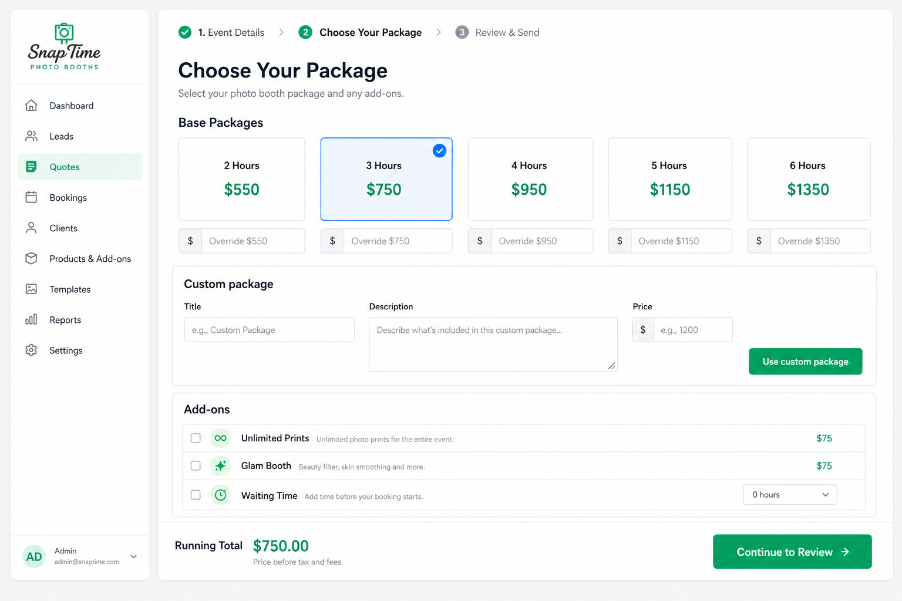

# Quote Tool

Admin quote builder at `/admin/quotes`. Three-step wizard: contact info → package & add-ons → review & download PDF.

## How the PDF is generated

**Approach:** Server-side **jsPDF** with imperative drawing code. There is **no HTML template**, no Puppeteer, and no react-pdf.

| Role | File |
|------|------|
| PDF builder | `app/api/quotes/generate-pdf/route.ts` |
| UI + trigger | `app/admin/quotes/page.tsx` → `downloadPDF()` |
| Pricing source | `app/api/quotes/pricing/route.ts` (DB `settings` key `pricing`, or hardcoded defaults) |

### Call chain

1. User clicks **Download Quote PDF** on step 3.
2. `downloadPDF()` in `page.tsx` builds a JSON payload (`contactInfo`, `package`, `addons`, `discount`, `subtotal`, `total`).
3. It POSTs to `/api/quotes/generate-pdf`.
4. The route creates `new jsPDF('p', 'mm', 'a4')` and draws everything inline: header bar, client block, line-item table, total banner, terms.
5. Returns `application/pdf` bytes; the browser saves the file via blob download.

Side effect: before the PDF request, the same handler POSTs a lead to `/api/leads` with `source: 'QUOTE'` (non-blocking on failure).

### Package shape sent to the PDF route

```ts
// Standard (hour-based)
{ kind: 'standard', hours: number, price: number }

// Custom (multi-day, free-form text)
{ kind: 'custom', title: string, description: string, price: number }
```

The PDF route normalizes this in `normalizePackage()` and renders:
- Standard → `"{hours} Hour Photo Booth Package"`
- Custom → bold title + wrapped description

Add-ons rendered as extra table rows: Unlimited Prints (hour-rate × package hours), Glam Booth ($75), Waiting Time ($50/hr).

### Implication for changes

To change PDF layout or copy, edit `generate-pdf/route.ts` directly. There is no separate template file to swap out. Styling is coordinates, `doc.text()`, `doc.rect()`, and helper functions like `drawRoundedRectBlue()`.

---

## Input form: package selection (step 2)

Packages are **clickable cards in a grid**, not a dropdown.

- **Base packages:** fixed list `[2, 3, 4, 5, 6]` hours. Each card shows `{hours} Hours` and price from pricing config. Clicking a card calls `selectPackage(hours)`.
- **Per-quote price override:** number input under each card (`packageOverrides`). Optional one-off price without changing global pricing.
- **Custom package:** separate section with Title, Description, Price fields and **Use custom package** button (for multi-day / non-hour packages).
- **Add-ons:** checkboxes for Unlimited Prints, Glam Booth, Waiting Time. Waiting Time reveals an **Hours** `<select>` (0–4).

Default prices (also in `pricing/route.ts`):

| Hours | Price |
|-------|-------|
| 2 | $550 |
| 3 | $750 |
| 4 | $950 |
| 5 | $1150 |
| 6 | $1350 |

### Adding a second (or new) duration

Today durations are hardcoded in two places on `page.tsx`:

1. Admin pricing editor: `{[2, 3, 4, 5, 6].map(...)}` (~line 522)
2. Quote builder cards: `{[2, 3, 4, 5, 6].map(...)}` (~line 900)

Also add the new hour key to `DEFAULT_PRICING.packages` in both `page.tsx` and `app/api/quotes/pricing/route.ts`, and save via admin pricing UI or DB.

UI pattern for a new duration: **add another card to the grid** (same click-to-select behavior), not a new dropdown option.

---

## Package selection UI (reference)



*Reference mock of step 2. Live page requires admin login at `/admin/quotes`.*
